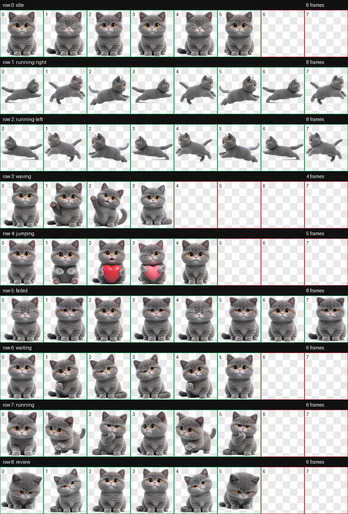
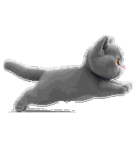

# Hatch Pet · 九儿桌宠工作流

AI 生图 + 确定性 Python 管线，从角色图批量孵化桌宠（spritesheet 图集），并支持在 macOS 桌面独立运行。



## 成品：九儿 v2.1

浅灰英短蓝猫 3D 渲染形象，基于同一 canonical base 逐帧编辑生成，配合 HSV 紫色域校正，全帧形象一致。

- **图集契约**：8×9，1536×1872 RGBA，单元格 192×208，共 57 帧
- **9 状态动画**：idle 眨眼呼吸 / running-right 真奔跑循环 / running-left 镜像 / waving 挥手 / jumping（点击）比心 heart-cute / waiting 期待 / running 打字工作循环 / review 低头审视 / failed 耷拉沮丧
- **点击互动**：jumping 行替换为比心五帧（平静→抬爪→抱红心→歪头眨眼→回位，140ms×4+280ms）
- **QA**：validate 零错误零警告、透明格 RGB 零残留、边缘去色渗（青边 −95%、绿边 −100%）

| idle | running-right | 比心（点击） |
|---|---|---|
|  |  |  |

## 目录结构

```
├── scripts/              # hatch-pet 生成管线（Pillow 确定性处理 + 可插拔生图后端）
├── 桌宠成品-九儿/         # 成品：9 个 GIF + spritesheet.webp + pet.json + 联络表
├── mac-pet/              # macOS 独立桌面宠物（tkinter，脱离 Codex/Trae 运行）
├── pets/                 # 桌宠安装包
├── staging/              # 生图暂存区
├── references/           # 参考素材
├── SKILL.md              # hatch-pet 技能说明（本环境复刻版）
└── hatch-pet-v2实战技巧学习笔记.md
```

## 使用方式

### 1. 在 Codex / Trae 中使用桌宠

```bash
mkdir -p ~/.codex/pets/jiuer
cp 桌宠成品-九儿/pet.json 桌宠成品-九儿/spritesheet.webp ~/.codex/pets/jiuer/
```

然后 Settings → Pets → Refresh → 选择九儿。唤醒/收起用 `/pet`。

### 2. macOS 桌面独立运行

双击 `mac-pet/九儿桌面宠物.app`，或终端运行：

```bash
python3 mac-pet/jiuer_desktop.py
```

操作：拖拽移动｜单击比心｜右键或 Esc 退出。依赖 tkinter（建议 miniconda Python）。

### 3. 用管线孵化自己的桌宠

```bash
# 1. 生成 base 形象（trae 后端，纯提示词）
python scripts/imagegen_generate.py \
  --prompt-file <run>/prompts/base-pet.md \
  --output <abs path>/base.png --backend trae

# 2. 逐状态生成行条/关键帧（需支持参考图的后端 + canonical base 锚定）

# 3. 切帧 → 组图集 → 校验 → 联络表 → GIF 预览
python scripts/compose_atlas.py --frames-root <frames> --output <atlas.png> --webp-output <atlas.webp>
python scripts/validate_atlas.py <atlas.png> --json-out validate.json
python scripts/make_contact_sheet.py <atlas.png> --output contact-sheet.png
python scripts/render_animation_previews.py --frames-root <frames> --output-dir previews/
```

详见 [SKILL.md](SKILL.md)。

## 关键工程经验

- **形象一致性**：所有帧从同一 canonical base 编辑生成，禁止每帧独立生成（会导致颜色漂移）
- **动作语义**：`running` = 工作循环不是跑步；镜像仅限完全对称角色；方向验收必须盲测（藏标签）
- **确定性后处理**：切帧三级降级（连通域→等宽切片→稳定视口）、透明格 RGB 归零、WebP 无损 `lossless=True, exact=True`、去色渗只跑最终一次
- 完整笔记见 [hatch-pet-v2实战技巧学习笔记.md](hatch-pet-v2实战技巧学习笔记.md)

## License

见 [LICENSE.txt](LICENSE.txt)。
